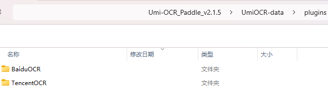
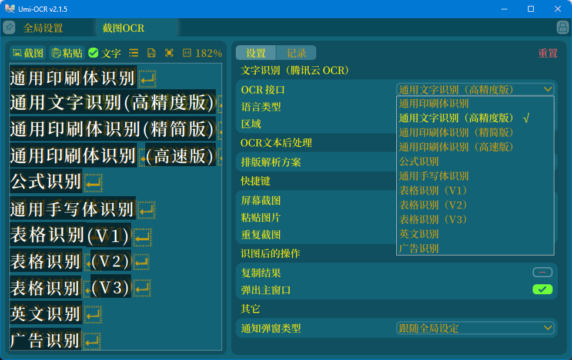
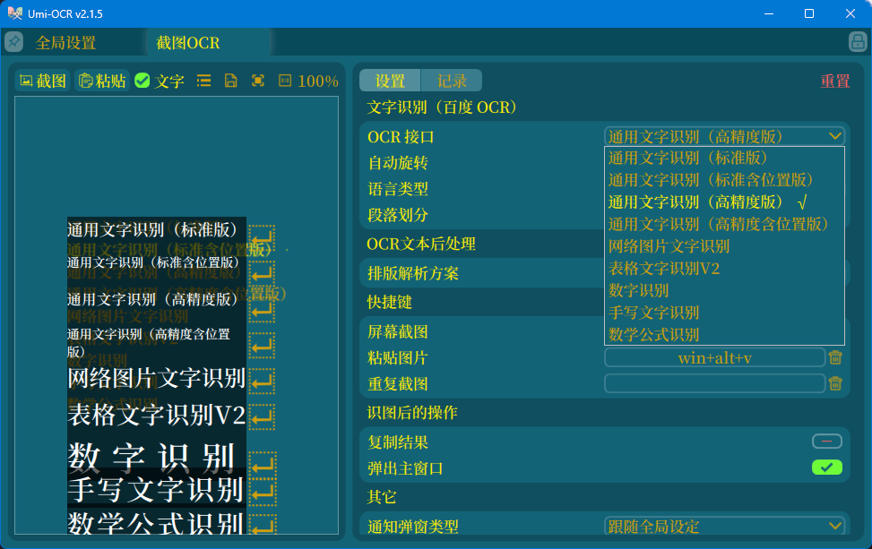

# Umi-OCR 在线 OCR 插件

本项目为 [Umi-OCR](https://github.com/hiroi-sora/Umi-OCR) 提供 **腾讯云 OCR** 与 **百度智能云 OCR** 的插件能力，便于在 Umi-OCR 中调用云端 OCR 服务。

## 特性

- 覆盖主流 OCR 接口（文本、手写、公式、表格）
- 即插即用，安装与配置简单
- 多语言识别
- 可配置超时、SSL 验证、调试日志等选项
- 统一错误结构，便于上层处理

## 安装方法

1. 将 `BaiduOCR` 与 `TencentOCR` 文件夹复制到插件目录：
   ```
   UmiOCR-data\plugins\
   ```
2. 重启 Umi-OCR，插件自动加载



## 配置步骤

### 1) 申请 API 密钥

参考 [PandaOCRPro 教程](https://www.showdoc.com.cn/PandaOCR/11558472866674591)：

- **腾讯云**：注册 [腾讯云](https://cloud.tencent.com/) 并开通 OCR，获取 `SecretId/SecretKey`
- **百度云**：注册 [百度智能云](https://cloud.baidu.com/) 并创建 OCR 应用，获取 `API Key/Secret Key`

### 2) 填写密钥

在 Umi-OCR 的**全局设置**中填写：


## 支持的接口

### 腾讯云 OCR（TencentOCR）

当前支持以下接口：

| 序号 | 接口名称 | 说明 |
|------|----------|------|
| 1 | 通用印刷体识别 | 适用于印刷文档、网络图片 |
| 2 | 通用文字识别（高精度版） | 精度更高 |
| 3 | 通用印刷体识别（精简版） | 轻量、速度快 |
| 4 | 通用印刷体识别（高速版） | 高速处理 |
| 5 | 公式识别 | 数学公式 |
| 6 | 通用手写体识别 | 手写文字 |
| 7 | 表格识别（V1） | 基础表格识别 |
| 8 | 英文识别 | 英文优化 |
| 9 | 广告识别 | 广告图片文字 |



### 百度云 OCR（BaiduOCR）

支持以下接口：

| 序号 | 接口名称 | 说明 |
|------|----------|------|
| 1 | 通用文字识别（标准版） | 基础文字识别 |
| 2 | 通用文字识别（标准含位置版） | 返回文字位置信息 |
| 3 | 通用文字识别（高精度版） | 高精度 |
| 4 | 通用文字识别（高精度含位置版） | 高精度 + 位置信息 |
| 5 | 网络图片文字识别 | 针对网络图片 |
| 6 | 表格文字识别 V2 | 表格内容识别 |
| 7 | 数字识别 | 纯数字 |
| 8 | 手写文字识别 | 手写内容 |
| 9 | 数学公式识别 | 数学公式 |



## 关键配置说明

- `timeout`：超时时间（腾讯/百度均支持，腾讯的 TableOCR 默认最少 60s）
- `ssl_verify`：是否验证 SSL 证书（建议保持开启）
- `debug_log`：输出插件调试日志（仅排查问题时开启）

## 错误返回结构（统一）

失败时返回：
```json
{
  "code": 102,
  "data": "[Error] ...",
  "error": {
    "message": "具体错误信息",
    "type": "auth | network | http | api | input | io | encode | request | config"
  }
}
```

## 费用说明

- 腾讯云 / 百度云均提供免费额度
- 超出额度后按量计费，详见官方定价

## 致谢

- [Umi-OCR](https://github.com/hiroi-sora/Umi-OCR)
- [腾讯云 OCR](https://cloud.tencent.com/product/ocr)
- [百度智能云 OCR](https://cloud.baidu.com/product/ocr)
